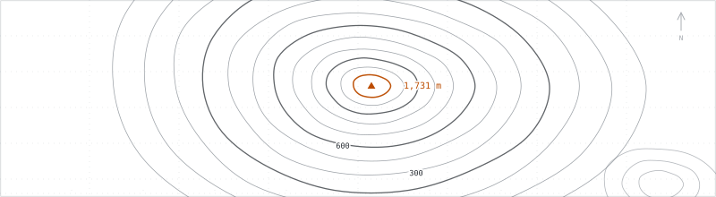

# volcanic

<picture>
  <source media="(prefers-color-scheme: dark)" srcset="assets/hero-contour-dark.svg" />
  <source media="(prefers-color-scheme: light)" srcset="assets/hero-contour-light.svg" />
  
</picture>

Something gets in my way; I would rather build the fix than learn to live with it.
Small tools, written fast, thrown straight into use — until the next thing gets in my way.

<picture>
  <source media="(prefers-color-scheme: dark)" srcset="assets/plate-dark.svg" />
  <source media="(prefers-color-scheme: light)" srcset="assets/plate-light.svg" />
  
</picture>

## When the commits land

<picture>
  <source media="(prefers-color-scheme: dark)" srcset="assets/diurnal-dark.svg" />
  <source media="(prefers-color-scheme: light)" srcset="assets/diurnal-light.svg" />
  
</picture>

<i><!-- survey:readings -->315 commits over the last twelve months, local time — 3 more than the last survey and one in nine of them after 22:00.<!-- /survey:readings --> <!--[...]</i>

## Pinned projects

下面列出的是当前 GitHub 主页置顶（pinned）的仓库，按展示顺序给出简短描述：

- [tech-daily](https://github.com/volcanicll/tech-daily) — 每日技术摘要，涵盖加密货币、人工智能和开发者新闻 (JavaScript)。
- [crypto-price-viewer](https://github.com/volcanicll/crypto-price-viewer) — 实时加密货币价格查看器，包含市场数据、供应信息和锁仓明细 (TypeScript)。
- [vscode-text-translator](https://github.com/volcanicll/vscode-text-translator) — 在 VS Code 中将选中内容翻译为目标语言，支持 Microsoft、DeepL、有道和腾讯等 API (TypeScript)。
- [local-group-chat](https://github.com/volcanicll/local-group-chat) — 基于局域网的聊天应用，使用 React + Node.js 实现实时消息与文件分享 (TypeScript)。
- [RcCalendar](https://github.com/volcanicll/RcCalendar) — 日历组件/项目 (TypeScript)。
- [bookmarks-converter](https://github.com/volcanicll/bookmarks-converter) — 书签格式转换工具 (HTML)。

## In the workshop

Not a portfolio — just what happens to be open on the desk. Each one started as something that got in my way:

**[cabledrop](https://github.com/volcanicll/cabledrop)** — files and clipboard between my Mac and whatever Android phone is on the desk, over a single USB cable. No cloud, no pairing, nothing to ins[...] 

**[glm-usage-monitor](https://github.com/volcanicll/glm-usage-monitor)** — coding-plan quota in the VS Code status bar, so it does not evaporate mid-refactor.

**[obsidian-md-publisher](https://github.com/volcanicll/obsidian-md-publisher)** — Markdown notes to a WeChat draft in one click. Ended a lot of copy-pasting.

**[kitup](https://github.com/volcanicll/kitup)** — one command to update every AI coding CLI on the machine. I had six of them installed and was updating none.

## Lately

Reading about fully homomorphic encryption, poking at Bitcoin's scripting corners, and finding out how far a coding agent can be driven without ever touching its own UI. Most of it does not work. That[...] 

*small tools, mostly for me*

<picture>
  <source media="(prefers-color-scheme: dark)" srcset="assets/scalebar-dark.svg" />
  <source media="(prefers-color-scheme: light)" srcset="assets/scalebar-light.svg" />
  
</picture>

