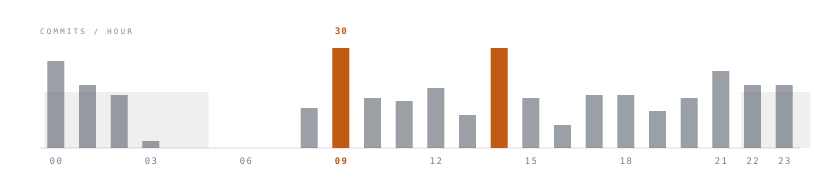

# volcanicll

Something gets in my way; I would rather build the fix than learn to live with it.

<!-- survey:plate -->333 commits / 12 mo · 80 active days · 25 repos · here since 2020<!-- /survey:plate -->

<picture>
  <source media="(prefers-color-scheme: dark)" srcset="assets/diurnal-dark.svg" />
  <source media="(prefers-color-scheme: light)" srcset="assets/diurnal-light.svg" />
  
</picture>

<i><!-- survey:readings -->1 fewer than the last survey, and one in nine commits after 22:00, local time.<!-- /survey:readings --> <!-- survey:sleep -->04:00–07:00 is empty because that is when I sleep. <!-- /survey:sleep -->The 22:00 spike is "<b>just one more thing</b>", which has never once been one thing.</i>

## Pinned

- **[tech-daily](https://github.com/volcanicll/tech-daily)** — a daily digest of crypto, AI and developer news. JavaScript.
- **[crypto-price-viewer](https://github.com/volcanicll/crypto-price-viewer)** — live prices, market data, supply and lock-up detail. TypeScript.
- **[vscode-text-translator](https://github.com/volcanicll/vscode-text-translator)** — translate the selection in VS Code, over Microsoft, DeepL, Youdao or Tencent. TypeScript.
- **[local-group-chat](https://github.com/volcanicll/local-group-chat)** — chat and file sharing on the LAN, React + Node.js. TypeScript.
- **[RcCalendar](https://github.com/volcanicll/RcCalendar)** — a calendar component. TypeScript.
- **[bookmarks-converter](https://github.com/volcanicll/bookmarks-converter)** — convert bookmarks between formats. HTML.

## In the workshop

Not a portfolio — just what happens to be open on the desk. Each one started as something that got in my way:

- **[cabledrop](https://github.com/volcanicll/cabledrop)** — files and clipboard between my Mac and whatever Android phone is on the desk, over a single USB cable. No cloud, no pairing, nothing to install on the phone.
- **[glm-usage-monitor](https://github.com/volcanicll/glm-usage-monitor)** — coding-plan quota in the VS Code status bar, so it does not evaporate mid-refactor.
- **[obsidian-md-publisher](https://github.com/volcanicll/obsidian-md-publisher)** — Markdown notes to a WeChat draft in one click. Ended a lot of copy-pasting.

## Lately

Reading about fully homomorphic encryption, poking at Bitcoin's scripting corners, and finding out how far a coding agent can be driven without ever touching its own UI. Most of it does not work. That is the fun part.
